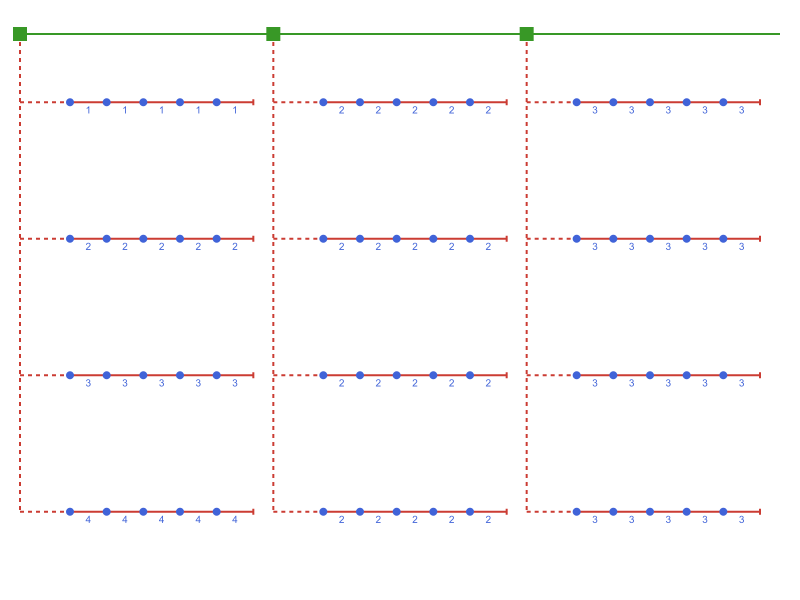
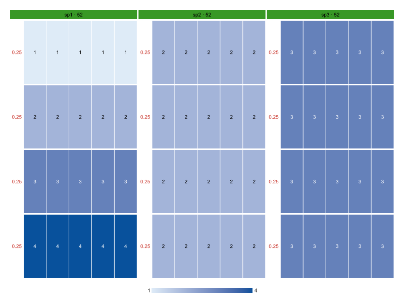
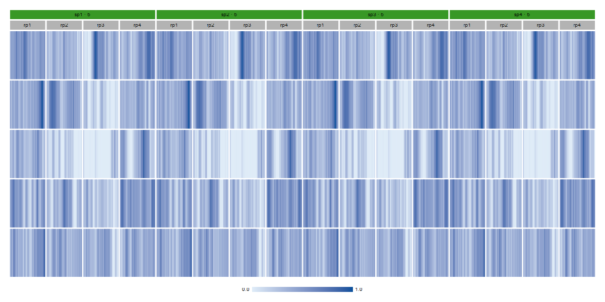

# TimeStructVisualizer

## Overview
This package provides functions for visualising time structures from the `TimeStruct.jl` package.
The plots are created using the Luxor package and can be displayed or stored in various formats.

## Usage

The example below shows how one can visualise a time structures with two levels.

```julia
using TimeStruct
using TimeStructVisualizer

ts = TwoLevel(3, 52, OperationalScenarios(4, SimpleTimes(5,1)))

cost = StrategicProfile(
    [
        ScenarioProfile([1, 2, 3, 4]),
        FixedProfile(2),
        FixedProfile(3)
    ]
)

TimeStructVisualizer.draw(ts; filename="example.svg", profile = cost, layout=:top)

```

This will produce the following figure



### Nested layout for complex time structures

For larger time structures, such as strategic periods with representative periods and
operational scenarios, or strategic scenario trees, the `:nested` layout is often easier to read.
Each level is drawn as blocks nested inside its parent, similar to icicle diagrams:

- time runs from left to right, with widths proportional to duration
  (and to the share of the year for representative periods),
- operational scenarios are stacked with heights proportional to their probability,
- in strategic trees, each node spans the rows of the leaves below it,
- profile values are shown as colors with a legend, which also works for many periods.

```julia
TimeStructVisualizer.draw(ts; filename="example_nested.svg", profile = cost, layout=:nested, showdur = true, showprob = true)
```



A more realistic example is given in [examples/wind_nested.jl](examples/wind_nested.jl): four
strategic periods of 5 years, where each year is represented by one week per season at hourly
resolution with five scenarios each, and the profile gives the hourly capacity factor for wind power.



## Drawing options

`TimeStructVisualizer.draw(ts; kwargs...)` supports `SimpleTimes`, `OperationalScenarios`,
`RepresentativePeriods`, `TwoLevel` and `TwoLevelTree`, and accepts the following keyword arguments:

| Keyword | Default | Description |
|---|---|---|
| `layout` | `:middle` | `:middle` connects each level at the middle of the level below it, `:top` shows strategic periods along the top with the rest hanging below, `:nested` draws each level as blocks nested inside its parent |
| `showdur` | `false` | Show the duration of operational and strategic periods |
| `showprob` | `false` | Show probabilities of scenarios and strategic nodes, and the share of representative periods |
| `profile` | `nothing` | A `TimeProfile` whose values are shown below each operational period, or as colors in the `:nested` layout |
| `filename` | `nothing` | Save the drawing to this file, with the format given by the extension (e.g. `.svg`, `.png`, `.pdf`) |
| `width`, `height` | `800`, `600` | Size of the drawing |
| `palette` | | Colors for operational time lines, strategic periods and operational periods |
| `style` | `DrawStyle()` | All visual settings, see below. Overrides `palette` |

Sizes, spacing and colors can be adjusted with a `DrawStyle`, for example

```julia
style = TimeStructVisualizer.DrawStyle(fontsize = 14, node_size = 20, palette = ["black", "orange", "purple"])
TimeStructVisualizer.draw(ts; style, showdur = true)
```

The available settings are `palette`, `label_color`, `frame_color`, `fontsize`, `margin`, `gap`,
`label_offset`, `frame_padding`, `marker_radius`, `node_size`, `branch_length` and `tick`, and for
the `:nested` layout `cell_color`, `value_colors`, `cell_separator`, `band_gap` and `legend_width`.
See `?TimeStructVisualizer.DrawStyle` for a description of each.